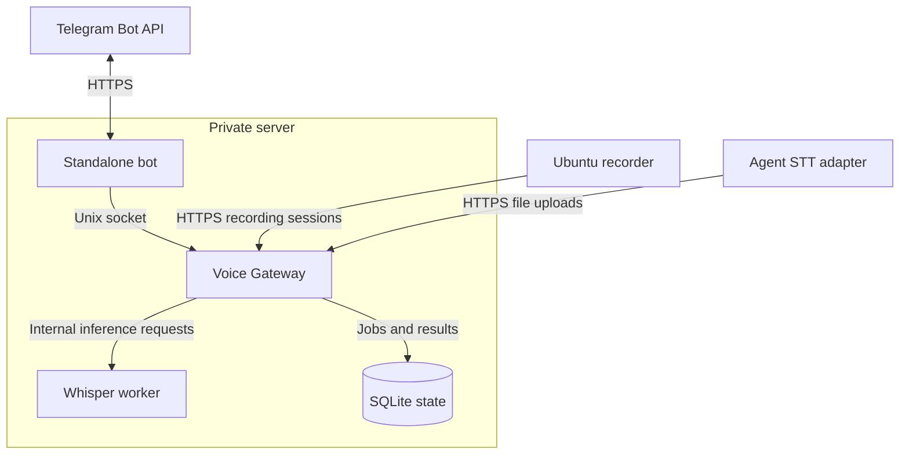

# InnerVoice

**Turn speech into text for the tools you already use.** InnerVoice is an open-source, self-hosted project powered by Whisper. Send a voice note to your agent or record on Ubuntu, then use the English text in your workflow. For example, you can speak an instruction in Spanish and have your agent receive it as an English prompt.

## Choose how to use it

| I want to… | Use |
| --- | --- |
| Speak to my agent through Telegram | The agent's Telegram connector passes the note to the private Voice Gateway. The agent receives one final English result and handles the reply. See the [agent provider guide](docs/private-gateway.md#agent-connection) and [reference adapter](clients/provider.py). |
| Get a transcript or translation in Telegram | The optional, single-user InnerVoice bot sends the result back in your Telegram chat. See the [bot guide](docs/private-gateway.md#server-audio-and-telegram) and [current bot source](bot/bot.py). |
| Dictate into a desktop app | The optional Ubuntu client lets you start and stop with a shortcut, edit text as it arrives, and copy the result. The Docker client uses Wayland. Run the client [in Docker](docs/private-gateway.md#run-the-desktop-client-in-docker) or [directly on Ubuntu](docs/private-gateway.md#run-directly-on-ubuntu). |

## Architecture

The private deployment runs inference on one server. The Ubuntu recorder and agent adapter reach the Voice Gateway over private HTTPS. The optional standalone bot runs alongside the Gateway and connects out to Telegram to receive notes and send replies.

**Desktop dictation.** The recorder captures mono 16 kHz audio locally. With live text enabled, it uploads numbered two-second WAV fragments and polls the session for text. Each preview replaces the unfinished tail in the editor. The Gateway assembles the fragments into 30-second windows for confirmed text. When you stop, the client finalizes the session and the worker processes any remaining audio. The editor preserves your corrections and copies the finished text to the clipboard. See [hotkey streaming and latency measurements](docs/hotkey-streaming.md).

**Whole-file jobs and Telegram.** The agent adapter uploads a file to `POST /v1/jobs` with an idempotency key so it can safely retry the same submission. The Gateway returns a job ID, and the adapter polls for the final English text. The standalone bot has its own bearer credential and sends audio segments through the Gateway’s Unix socket. It returns a transcript, translation or both to the authorized Telegram chat. Audio sent this way passes through Telegram before reaching the private server.

**Shared inference.** The Gateway schedules work for one active engine, OpenAI Whisper (PyTorch) or faster-whisper (CTranslate2), using local model weights. Interactive dictation takes priority over background bot work. A request already running on the worker can still delay the next result. Only the Gateway’s private HTTPS port is published. See [worker configuration and recovery](docs/private-gateway.md#cli-reference).

**Where data lives.** Server-side audio scratch files use bounded RAM-backed filesystems. An interrupted container can lose unfinished audio. The Gateway keeps job metadata and transcripts in SQLite under the configured retention policy. The desktop keeps its own recording history for playback and retry, including after a successful transcription. See [server storage and Telegram](docs/private-gateway.md#server-audio-and-telegram) and [workstation storage](docs/private-gateway.md#desktop-role).

## Get started

Follow [INSTALL.md](INSTALL.md) for a clean install, direct Meshnet access and the Ubuntu application launcher.

1. **Set up the server.** You'll need Linux, Docker Compose, a private network endpoint and a local multilingual Whisper model. The setup wizard can create the TLS certificate. Follow [server provisioning](docs/private-gateway.md#provision-the-server).
2. **Verify the Gateway directly.** Run `./bin/innervoice start --setup` to configure and start it. Follow the [CLI quickstart](docs/private-gateway.md#gateway-quickstart). Run the [direct smoke check](docs/private-gateway.md#direct-smoke-first) with a short synthetic audio fixture.
3. **Connect one client.** Follow the setup guide for your [agent](docs/private-gateway.md#agent-connection), [standalone bot](docs/private-gateway.md#server-audio-and-telegram) or [Ubuntu desktop](docs/private-gateway.md#desktop-role).

The private Gateway and full-file agent integration are **Release A**. The desktop recorder and incremental session API are **Release B**. Deployment acceptance is pending. Release B also requires checks in a graphical Ubuntu session after Release A is accepted.

## Everyday use

| From | Action |
| --- | --- |
| Server | Run `./bin/innervoice config worker` to choose Whisper settings, then `./bin/innervoice restart` to apply them with the saved connection. |
| Ubuntu workstation | Run `./bin/innervoice-desktop power` to turn dictation on or off. Press the configured shortcut to record, press again to finish, then paste the copied text wherever you need it. |
| Desktop storage | Run `./bin/innervoice-desktop storage` to see the folder, usage and 2 GiB default audio limit. See the [desktop guide](docs/private-gateway.md#desktop-role) to change the limit or preview cleanup. |
| Agent host | Run `./bin/innervoice agent setup` once with its own jobs credential. Point the STT provider at the saved client settings. |

See [daily commands and mesh access](docs/private-gateway.md#daily-operation-and-network-boundaries) for the panel indicator, credential scopes, port exposure and clipboard privacy.

## Documentation and source

| Resource | What you'll find |
| --- | --- |
| [Private Gateway and desktop guide](docs/private-gateway.md) | Provisioning, TLS, test fixtures, agent setup, desktop recovery and acceptance. |
| [CLI reference](docs/private-gateway.md#cli-reference) and [updates and rollback](docs/private-gateway.md#update-an-existing-gateway-deployment) | Setup, lifecycle, diagnostics, engine switching, maintenance and recovery. The entry point is [bin/innervoice](bin/innervoice). |
| [Documentation archive](docs/archive/README.md) and [changelog](CHANGELOG.md) | Previous deployment instructions, migration context and version history. |
| [Repository map](FILES.md) | Active source, build files and historical helpers. |
| [Compose services](docker-compose.yml), [private deployment overlay](compose.private.yml) and [environment example](.env.example) | Service boundaries and deployment configuration. |
| [Gateway job API](gateway/jobs.py), [recording session API](gateway/sessions.py) and [direct smoke client](clients/smoke.py) | Reference code for jobs, incremental recording and end-to-end verification. |
| [Whisper worker](whisper/whisper_server.py) | Local inference and model handling. |

## License

InnerVoice's source code is released under the [MIT License](LICENSE). Third-party libraries and model weights are governed by their own licenses.

## Project support

InnerVoice is maintained by [Arkano21](https://t.me/arkano21). Report issues or propose changes through [GitHub](https://github.com/arkano1dev/InnerVoice/issues). Use synthetic examples in public reports.

- Bitcoin — `bc1qwktevffc57rkk8lwyd6yqwxrvcd4vjxggcpsrn`
- Lightning — `buffswan6@primal.net`
- Nostr — `npub1p2x3t3njq44vsk24qjkauzurvfd59c224qyu2mpgu9jverk9tfrqnz0ql5`
